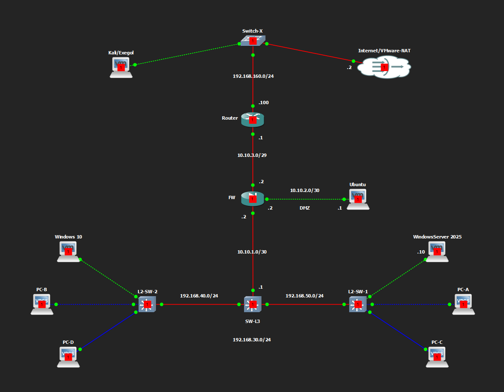

# HomeLab - Network Documentation



## Overview

HomeLab is a GNS3 lab built on a single laptop (OMEN 16, i7-14650HX, 32 GB RAM, RTX 4060 8 GB) to practice networking, systems administration, and offensive security in one environment. It models a perimeter with a firewall (Cisco ASAv), a DMZ (Ubuntu Server), a routed core (SW-L3 + two access switches), and an Active Directory domain **kooler.local** running on Windows Server 2025. Attacker platforms (Kali, Exegol) sit on the untrusted outside segment alongside a NAT gateway to the internet. The number of assets, host types, and configured services is based on my host specs, so that the entire environment can run simultaneously without the PC sweating too much and the VMs get decent resources. If you have questions or ideas to share, feel free to post in the [discussion](https://github.com/Ko0ler/HomeLab/discussions) section.

**Note**: This is a baseline setup to get started with, so customize as needed. Tools and concepts like server hardening, SIEM, EDR, C2 server, and LAN pivoting for further testing are left for you to implement, depending on what you want to train on. Only the global architecture will be documented over time and tracked in [CHANGELOG.md](Docs/CHANGELOG.md). In addition, if the ASAv firewall is in evaluation mode like mine, the bandwidth is throttled and capped at 100 Kbps, which can affect network performance (external source → DMZ, inside → Internet). So I temporarily use an additional network adapter on the VMs (VMware NAT) for demanding network traffic like system updates or large software downloads. Take snapshots of components as you test and break stuff. Enjoy and grow!

## ⚠️ Disclaimer & Responsible Use

This repository documents a **personal, isolated lab built for education and skills practice**. By using anything in it, you agree to the following:

- **Authorized use only.** Use the attack tooling and techniques described here **only against systems you own or have explicit written permission to test**. Never point them at third-party systems, networks, or services.
- **Keep the lab isolated.** The lab contains **intentionally vulnerable applications** (DVWA, bWAPP, a default WordPress stack, httpbin) and a deliberately over-provisioned, misconfigured domain controller. Run it only on NAT or host-only networking. **Never expose it to a shared network or the internet.**
- **Lab credentials are throwaway.** Use unique, lab-only passwords, change every default before use, and never reuse real credentials. No secrets are committed to this repo.
- **Review before applying.** Configs and scripts are written for this specific topology and addressing plan. Read them before running them, especially on a machine or network you care about. Take a snapshot first.
- **Licensing is your responsibility.** Cisco images (IOSv, IOSv L2, ASAv), Microsoft operating systems, and other third-party software are **not included** and remain subject to their own licenses and terms.
- **No warranty, no liability.** Everything is provided "as is" under the [MIT License](LICENSE), without warranty of any kind. The author is not responsible for damage, data loss, or legal consequences resulting from use or misuse of this material.

## Quick Start

A condensed path to get the lab running. Details for each piece are in the sections below.

### Prerequisites

- **Host:** a machine able to run GNS3 plus several VMs at once. The reference build uses 32 GB RAM and a modern 14th-gen i7; 16 GB of RAM is fine if you leave some VMs turned off.
- **Software:** GNS3 (server + GUI) and VMware Workstation. The VMs and the GNS3 nodes must be able to talk to each other (VMware NAT/host-only adapters).
- **Images (not included):** Cisco IOSv, IOSv L2, and ASAv for GNS3; Kali (and optionally Exegol); Ubuntu Desktop; Windows Server 2025; Windows 10.

### Repository layout

```text
HomeLab/
├── Docs/
│   ├── Topology.png      # Topology diagram
│   └── CHANGELOG.md      # CHANGELOG
├── Configs/
│   ├── Appliance/        # Router, FW, SW-L3, L2-SW-1, L2-SW-2 configs
│   └── VM/
│       ├── Attack Host/  # Kali setup script + README
│       └── Ubuntu/       # DMZ target setup script + README
├── CONTRIBUTING.md
└── LICENSE
```

### Steps

1. **Clone the repo**
   ```bash
   git clone https://github.com/Ko0ler/HomeLab.git
   cd HomeLab
   ```
2. **Build the topology in GNS3.** Recreate the nodes and links from `Docs/Topology.png`, using the [addressing table](#network-topology--addressing) below.
3. **Apply the appliance configs** from `Configs/Appliance/`, in this order: `SW-L3.cfg`, `L2-SW-1.cfg`, `L2-SW-2.cfg`, `Router.cfg`, then `FW.cfg`. Open each file and review it first. Replace any values specific to your environment, then paste it into the node console.
4. **Prepare the VMs:**
   - Attack host (Kali): run `Configs/VM/Attack Host/InitialSetup.sh`. See its [README](Configs/VM/Attack%20Host/README.md).
   - Target host (Ubuntu, DMZ): run `Configs/VM/Ubuntu/InitialSetup.sh`. See its [README](Configs/VM/Ubuntu/README.md).
5. **Build the Active Directory side manually** on the Windows Server 2025 VM (ADDS, ADCS, DHCP, DNS, MSSQL, domain **kooler.local**), then join the Windows 10 workstation. This part is not yet scripted.
6. **Verify connectivity** before testing anything:
   ```bash
   # From the attack host: reach the published DMZ address
   ping -c 3 [DMZ_MAPPED_IP]
   curl -I http://[DMZ_MAPPED_IP]:[SERVICE_PORT]

   # From an inside host: reach the DMZ and the internet
   ping [DMZ_HOST_IP]
   ping [INTERNET_TEST_IP]
   ```
   On the ASA, `show nameif`, `show xlate` and `show conn` confirm interfaces, NAT, and active flows.
7. **Snapshot everything** once it works, then start breaking things.

> The ASAv bandwidth cap in evaluation mode (see the Note above) makes DMZ and internet traffic slow. This is expected, not a misconfiguration.

## Network Topology & Addressing

Chain: **Kali/Exegol + NAT (Switch-X)** → **Router** → **ASAv Firewall** (with DMZ leg) → **SW-L3** → **L2-SW-1 / L2-SW-2** (VLANs).

| Segment | Subnet | Notes |
| --- | --- | --- |
| Outside / untrusted | 192.168.160.0/24 | Switch-X: Kali/Exegol, NAT cloud; Router at .100 |
| Router ↔ FW outside | 10.10.3.0/29 | Router .1, ASA outside .2, DMZ NAT .3 |
| FW ↔ DMZ | 10.10.2.0/30 | ASA dmz .2, Ubuntu .1 |
| FW ↔ SW-L3 (inside) | 10.10.1.0/30 | ASA inside .2, SW-L3 .1 |
| VLAN 30 (VPCS) | 192.168.30.0/24 | PC-C, PC-D |
| VLAN 40 (Workstations) | 192.168.40.0/24 | behind L2-SW-2 — Windows 10, PC-B |
| VLAN 50 (Servers) | 192.168.50.0/24 | behind L2-SW-1 — Windows Server 2025 (DC01), PC-A |
| VLAN 100 (Management) | 192.168.100.0/24 | SVI present on SW-L3; trunked, not yet in ASA object group |

Trunk links SW-L3 ↔ L2-SW-1/L2-SW-2 carry VLANs 30, 40, 50, 100 (native VLAN 999, dot1q).

## Network Device Inventory

| Device | Role | Platform | Key interfaces |
| --- | --- | --- | --- |
| Router | Edge router, NAT-side gateway | Cisco IOSv 15.9 | Gi0/0 10.10.3.1/29 (to FW); Gi0/1 192.168.160.100/24 (to Switch-X) |
| FW | Perimeter firewall, DMZ | Cisco ASAv 9.22(1)1 | outside 10.10.3.2/29; dmz 10.10.2.2/30; inside 10.10.1.2/30 |
| SW-L3 | Core L3 switch, inter-VLAN routing | Cisco IOSv L2 15.2 | Gi0/0 10.10.1.1/30 (to FW); Gi0/1-0/2 trunks to L2-SW-1/2; SVIs for VLAN 30/40/50/100; VTP server mode |
| L2-SW-1 | Access switch | Cisco IOSv L2 15.2 | VLAN 50 access ports (WinServer2025, PC-A); VTP client mode |
| L2-SW-2 | Access switch | Cisco IOSv L2 15.2 | VLAN 40 access ports (Windows 10, PC-B); VLAN 30 (PC-D); VTP client mode |

ASAv is licensed under Smart Licensing Using Policy, running in Evaluation Mode with feature tier **standard** and throughput level **1G** declared locally (no CSSM registration).

## Host Inventory

| Host / Resources | OS / Build | Hostname | IP / VLAN | Services |
| --- | --- | --- | --- | --- |
| Kali (1 CPU, 8 Cores, 4/80GB) | Kali Linux 2026.2 (VMware amd64) | Kali | 192.168.160.130 (outside segment) | Attacker platform |
| Ubuntu (1 CPU, 2 Cores, 3/60GB) | Ubuntu Desktop 26.04 | ko0ler-VMware-Virtual-Platform | 10.10.2.1 (DMZ) | WordPress stack, DVWA, bWAPP, httpbin |
| Windows Server 2025 (1 CPU, 4 Cores, 4/60GB) | Windows Server 2025 | DC01 | 192.168.50.10 (VLAN 50) | ADCS, ADDS, DHCP, DNS, MSSQL — domain controller for kooler.local |
| Windows 10 (1 CPU, 2 Cores, 4/60GB) | Windows 10 | PC1 | DHCP (VLAN 40) | Domain-joined workstation |
| PC-A | VPCS | — | VLAN 50 (.15) | — |
| PC-B | VPCS | — | VLAN 40 (.15) | — |
| PC-C | VPCS | — | VLAN 30 (.1) | — |
| PC-D | VPCS | — | VLAN 30 (.2) | — |

VPCS are mainly used for connectivity testing. I created setup scripts for the attack host (Kali) [here](Configs/VM/Attack%20Host/InitialSetup.sh) and the target host (Ubuntu) [here](Configs/VM/Ubuntu/InitialSetup.sh).

## Active Directory (kooler.local)

Domain controller: **DC01** (Windows Server 2025, 192.168.50.10), running ADCS, ADDS, DHCP, DNS, and MSSQL side by side — a deliberately over-provisioned DC for attack-surface practice (service account exposure, ADCS template misconfiguration, SQL on a DC, etc.).

| Account | Scope | Notes |
| --- | --- | --- |
| Administrator | Local (DC01) | Built-in local admin |
| Ko0ler | Domain user | — |
| user1 | Domain user | — |

Windows 10 (PC1) is joined to kooler.local; the local login `ko0ler` also exists on that machine, separate from the domain account.

## Firewall Policy Summary (ASAv)

| Zone pair | Direction | Allowed |
| --- | --- | --- |
| outside → DMZ | inbound | HTTP (80), HTTPS (443), DVWA (8080), bWAPP (8070), httpbin (8060), WordPress (8050) to Ubuntu (10.10.2.1); ICMP |
| DMZ → outside | outbound | HTTP, HTTPS, DNS (53) |
| DMZ → inside | — | denied |
| inside → DMZ | outbound | full IP to Ubuntu except SSH (only accessible on VLAN 50) |
| inside → outside | outbound | full IP, PAT via ASA outside interface |

NAT: PAT for inside subnets (192.168.30/40/50.0/24, dynamic, via ASA outside) and static NAT for the DMZ host (10.10.2.1 → 10.10.3.3, DMZ\_MAPPED). Note: inter-VLAN traffic between VLANs 30/40/50 never crosses the ASA — SW-L3 routes it locally, so the firewall only sees north-south (DMZ/outside) traffic.

## Known Issues & Changelog

Tracked in [CHANGELOG.md](Docs/CHANGELOG.md).

## Credentials Reference

Lab credentials are intentionally **not committed** to this repository.

| Scope | Account | Hostname |
| --- | --- | --- |
| Local | kali |  Kali |
| Local | ko0ler | ko0ler-VMware-Virtual-Platform (Ubuntu) |
| Local | ko0ler | PC1 (Windows 10) |
| Local | Administrator | DC01 (WindowsServer 2025) |
| Domain (kooler.local) | Ko0ler | — |
| Domain (kooler.local) | user1 | — |

## Contributing

See [CONTRIBUTING.md](CONTRIBUTING.md). Suggestions, corrections, and "why did you do it this way" questions are welcome.

## License

Released under the [MIT License](LICENSE). See the [Disclaimer & Responsible Use](#️-disclaimer--responsible-use) section above before using anything in this repository.
